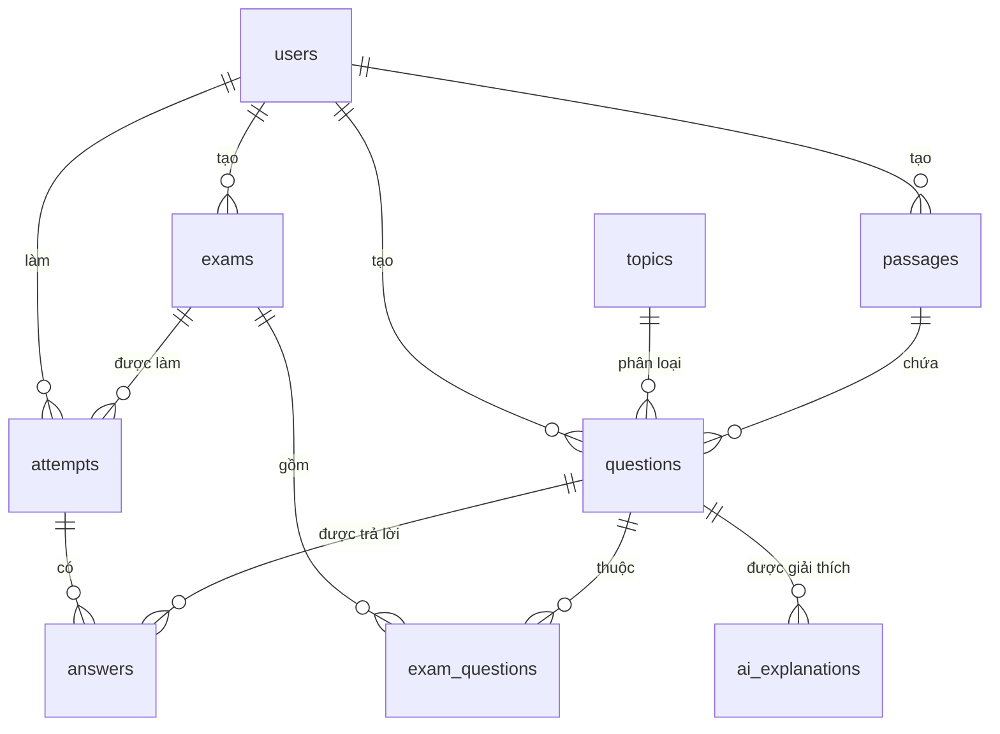

# Kiến trúc hệ thống

## 1. Tổng quan
```text
Trình duyệt ──> Next.js (cổng 3002) ──/api/* (rewrite)──> NestJS (cổng 3001) ──> PostgreSQL (cổng 5434)
```

- **Frontend:** Next.js App Router, TypeScript, Tailwind CSS. Trình duyệt chỉ gọi `/api/*` cùng nguồn, Next.js chuyển tiếp sang backend.
- **Backend:** NestJS, chia module theo nghiệp vụ. Mọi kiểm tra quyền và chấm điểm nằm ở đây.
- **CSDL:** PostgreSQL chạy bằng Docker Compose, truy cập qua Prisma. Dùng cổng 5434 vì máy phát triển đã có dịch vụ ở 5432 và 5433; frontend dùng 3002 vì 3000 cũng đã bị chiếm.
- **Phiên bản:** dùng bản ổn định mới nhất, gồm Node 26 và Prisma 7.

## 2. Xác thực
- Đăng nhập trả JWT trong cookie `access_token` có `HttpOnly`, `SameSite=Lax`, và `Secure` khi chạy production. JavaScript trên trang không đọc được token.
- Backend cũng nhận header `Authorization: Bearer`, dùng cho test và công cụ dòng lệnh.
- `JwtAuthGuard` và `RolesGuard` đăng ký toàn cục: mọi endpoint mặc định cần đăng nhập, endpoint công khai phải khai báo `@Public()` rõ ràng.

## 3. ERD


## 4. Giải thích từng bảng
| Bảng | Vai trò | Trường đáng chú ý |
|---|---|---|
| `users` | Tài khoản | `email` duy nhất, `password_hash`, `role` (`STUDENT`, `TEACHER`) |
| `topics` | Chủ đề để lọc và thống kê | `name` duy nhất |
| `passages` | Đoạn văn của Part 6, 7 | `title`, `content`, `source`, `license` |
| `questions` | Ngân hàng câu hỏi | `part`, `content`, `options` (4 lựa chọn), `correct_option`, `difficulty`, `explanation`, `source`, `license`, `audio_url`, `transcript`, `archived_at` |
| `exams` | Đề thi hoặc bộ ôn tập | `kind` (`STANDARD`, `REVIEW`), `status` (`DRAFT`, `PUBLISHED`), `duration_minutes` |
| `exam_questions` | Liên kết đề và câu | Khóa chính (`exam_id`, `question_id`), `position` duy nhất trong đề |
| `attempts` | Một lượt làm bài | `status`, `started_at`, `expires_at`, `submitted_at`, `auto_submitted`, `correct_count`, `total_questions`, `estimated_score` |
| `answers` | Câu trả lời trong một lượt | Khóa chính (`attempt_id`, `question_id`), `selected_option`, `is_flagged`, `is_correct` |
| `ai_explanations` | Cache lời giải thích AI | Duy nhất theo (`question_id`, `selected_option`, `prompt_version`), `content`, `model`, `helpful_count`, `not_helpful_count` |
| `ai_usage` | Số lượt gọi AI mỗi ngày | Khóa chính (`user_id`, `date`), `count`; ngày theo giờ Việt Nam |
| `ai_explanation_feedback` | Phản hồi hữu ích hay không | Khóa chính (`explanation_id`, `user_id`), `helpful` |

## 5. Quan hệ
- `topics` 1-n `questions`: mỗi câu có đúng một chủ đề, nhờ đó thống kê điểm yếu không bị đếm trùng.
- `passages` 1-n `questions`: `passage_id` để trống với Part 5; một đoạn văn có nhiều câu.
- `exams` n-n `questions` qua `exam_questions`: một câu dùng lại được ở nhiều đề, `position` giữ thứ tự.
- `users` 1-n `attempts`, `exams` 1-n `attempts`: một học viên làm một đề nhiều lần.
- `attempts` 1-n `answers`: `is_correct` chỉ có giá trị sau khi chấm.
- `exams.created_by_id` vừa là giáo viên tạo đề, vừa là học viên sở hữu bộ ôn tập (`kind = REVIEW`).

## 6. Quyết định thiết kế
- **Không xóa cứng câu hỏi đã dùng:** `archived_at` giữ lại câu cũ, để kết quả lịch sử không thay đổi.
- **Một lượt đang làm:** chỉ mục duy nhất một phần trên (`user_id`, `exam_id`) với điều kiện `status = 'IN_PROGRESS'`, tránh tạo trùng khi bấm nhanh.
- **Không tin đồng hồ trình duyệt:** `expires_at` tính ở máy chủ; khi bắt đầu lượt, trình duyệt chỉ nhận số giây còn lại để hiển thị.
- **Hết giờ:** không nhận lưu thêm. Lượt quá hạn được chấm theo câu đã lưu khi có yêu cầu kế tiếp liên quan đến lượt đó, và đánh dấu `auto_submitted`.
- **Nộp một lần:** lưu nháp và chấm bài đều khóa dòng `attempts` bằng `SELECT ... FOR UPDATE` trong giao dịch. Yêu cầu nộp thứ hai chờ khóa, thấy bài đã nộp và nhận 409.
- **Không lộ đáp án:** truy vấn đề thi cho học viên dùng `select` liệt kê từng trường được phép, nên đáp án không được lấy ra khỏi CSDL. Chỉ endpoint kết quả của lượt đã nộp mới đọc đáp án.
- **Phiên làm bài:** phòng thi gọi `POST /auth/refresh` định kỳ, vì đề có thể dài hơn thời hạn token.
- **Điểm ước lượng:** `max(5, round(495 × đúng / tổng ÷ 5) × 5)`. Đây là quy đổi tuyến tính, không phải bảng điểm chính thức của ETS.

- **Giải thích bằng AI:** gọi REST của Gemini bằng `fetch`, prompt nằm ở `backend/prompts`. Đầu ra luôn được kiểm tra lại. Lỗi 500, 503 được thử lại tối đa 2 lần; lỗi 429 dừng ngay vì là hết hạn mức; đầu ra sai định dạng thử lại 1 lần. Lượt trong ngày tăng bằng một câu SQL nguyên tử và được hoàn khi gọi thất bại.

## 7. Module backend
| Module | Trách nhiệm |
|---|---|
| `auth` | Đăng ký, đăng nhập, JWT, guard |
| `topics`, `passages`, `questions` | Ngân hàng câu hỏi |
| `exams` | Tạo đề, chọn ngẫu nhiên, xuất bản |
| `attempts` | Làm bài, lưu nháp, nộp, chấm điểm, kết quả |
| `stats` | Thống kê học viên |
| `recommendations` | Gợi ý ôn tập |
| `teacher-stats` | Thống kê giáo viên |
| `ai` | Gọi Gemini, cache, giới hạn lượt, phản hồi |

## 8. API theo màn hình
Tiền tố `/api`. Đặc tả đầy đủ trong [`openapi.yaml`](openapi.yaml).

| Màn hình | Endpoint |
|---|---|
| Đăng nhập | `POST /auth/register`, `POST /auth/login`, `POST /auth/logout`, `GET /auth/me` |
| Trang chủ học viên | `GET /stats/me/overview`, `GET /stats/me/topics`, `GET /attempts` |
| Danh sách đề | `GET /exams`, `POST /exams/{id}/attempts` |
| Phòng thi | `GET /attempts/{id}`, `PUT /attempts/{id}/answers`, `POST /attempts/{id}/submit` |
| Kết quả | `GET /attempts/{id}/result`, `POST /attempts/{id}/questions/{questionId}/explanation`, `POST /ai-explanations/{id}/feedback` |
| Điểm yếu và gợi ý | `GET /stats/me/topics`, `GET /stats/me/trend`, `GET /recommendations`, `POST /recommendations/review-sets` |
| Ngân hàng câu hỏi | `GET, POST /questions`, `GET, PATCH, DELETE /questions/{id}`, tương tự `/passages`, `GET, POST /topics` |
| Tạo đề | `POST /exams`, `POST /exams/random`, `GET, PATCH, DELETE /exams/{id}`, `POST /exams/{id}/publish` |
| Thống kê giáo viên | `GET /teacher/stats/overview`, `/topics`, `/hardest-questions`, `/students-at-risk` |
| Hệ thống | `GET /health` |
