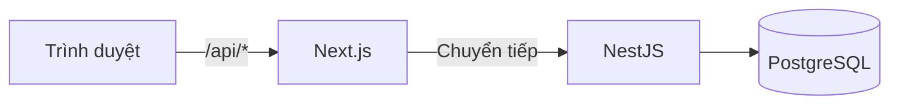
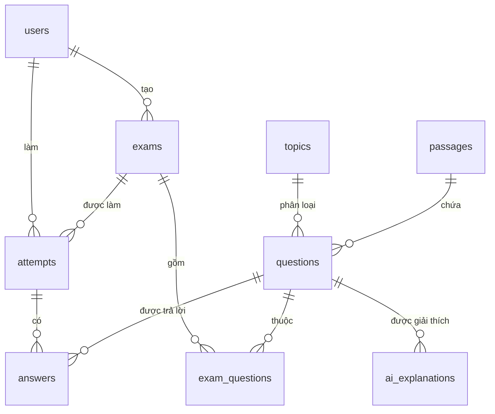
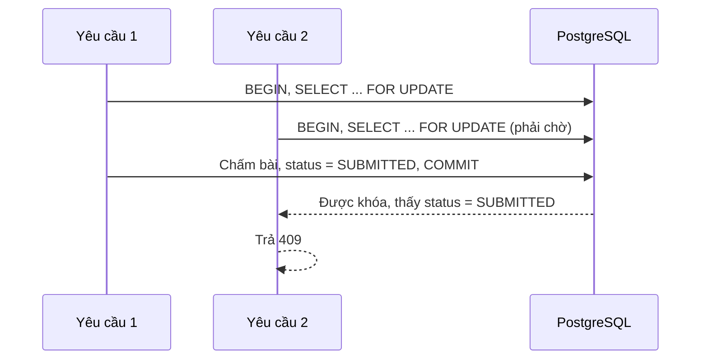

# BÁO CÁO ĐỒ ÁN TỐT NGHIỆP

**Đề tài:** Hệ thống luyện thi TOEIC Reading có AI giải thích và gợi ý ôn tập

| | |
|---|---|
| Sinh viên thực hiện | `[CẦN BỔ SUNG]` |
| Giảng viên hướng dẫn | `[CẦN BỔ SUNG]` |
| Trường, khoa | `[CẦN BỔ SUNG]` |
| Năm | `[CẦN BỔ SUNG]` |

> **Bản nháp.** Chưa có mẫu của trường. Tính năng AI giải thích đáp án chưa triển khai.

## Việc còn thiếu
Số chỗ đánh dấu trong từng chương, chưa tính trang tiêu đề ở trên.

| Chương | CẦN SỐ LIỆU | CHƯA TRIỂN KHAI | CẦN TRÍCH DẪN | CẦN BỔ SUNG |
|---|---|---|---|---|
| Chương 1 | 1 | 2 | 1 | 1 |
| Chương 2 | 0 | 1 | 7 | 0 |
| Chương 3 | 0 | 1 | 0 | 1 |
| Chương 4 | 1 | 1 | 0 | 1 |
| Chương 5 | 3 | 1 | 0 | 0 |
| Chương 6 | 0 | 1 | 0 | 1 |
| **Tổng** | **5** | **7** | **8** | **4** |

## Mục lục
- [Chương 1. Tổng quan đề tài](#chương-1-tổng-quan-đề-tài)
- [Chương 2. Cơ sở lý thuyết](#chương-2-cơ-sở-lý-thuyết)
- [Chương 3. Phân tích và thiết kế hệ thống](#chương-3-phân-tích-và-thiết-kế-hệ-thống)
- [Chương 4. Cài đặt hệ thống](#chương-4-cài-đặt-hệ-thống)
- [Chương 5. Kiểm thử và đánh giá](#chương-5-kiểm-thử-và-đánh-giá)
- [Chương 6. Kết luận và hướng phát triển](#chương-6-kết-luận-và-hướng-phát-triển)
- [Tài liệu tham khảo](#tài-liệu-tham-khảo)

---

# Chương 1. Tổng quan đề tài

## 1.1. Lý do chọn đề tài
TOEIC là chứng chỉ tiếng Anh được dùng phổ biến trong môi trường làm việc và chuẩn đầu ra ở nhiều trường đại học tại Việt Nam `[CẦN TRÍCH DẪN]`. `[CẦN SỐ LIỆU: tỷ lệ sinh viên cần chứng chỉ, số người dự thi nếu có nguồn]`

Người tự luyện TOEIC Reading thường gặp ba khó khăn. Thứ nhất, họ biết mình sai câu nào nhưng khó biết mình yếu ở dạng kiến thức nào. Thứ hai, luyện đề không bấm giờ thì không tạo được áp lực như phòng thi thật. Thứ ba, sau khi làm đề, họ không biết nên ôn gì tiếp theo. `[CẦN BỔ SUNG: nhận định này nên có khảo sát hoặc nguồn dẫn]`

Đề tài xây dựng một hệ thống web giúp người học luyện đề trong điều kiện bấm giờ, xem thống kê điểm yếu theo chủ đề, nhận bộ câu hỏi ôn tập phù hợp, và được giải thích đáp án bằng AI. Giáo viên có công cụ quản lý câu hỏi, tạo đề và theo dõi học viên.

## 1.2. Mục tiêu
| Mục tiêu | Trạng thái |
|---|---|
| Luyện đề TOEIC Reading có đếm giờ, tự lưu bài | Đã hoàn thành |
| Chấm điểm tự động, thống kê điểm yếu theo chủ đề | Đã hoàn thành |
| Gợi ý bộ ôn tập dựa trên kết quả của từng học viên | Đã hoàn thành (theo luật) |
| Công cụ cho giáo viên: ngân hàng câu hỏi, tạo đề, thống kê | Đã hoàn thành |
| Giải thích đáp án bằng AI | `[CHƯA TRIỂN KHAI]` |
| Đánh giá chất lượng giải thích của AI | `[CHƯA TRIỂN KHAI]` |

## 1.3. Đối tượng sử dụng
- **Học viên:** người đang luyện thi TOEIC Reading.
- **Giáo viên:** người soạn câu hỏi, tạo đề và theo dõi kết quả.

## 1.4. Phạm vi
**Trong phạm vi:** TOEIC Reading gồm Part 5, 6, 7; ứng dụng web tiếng Việt; hai vai trò học viên và giáo viên.

**Ngoài phạm vi:**
- Phần Listening. Cơ sở dữ liệu đã chừa trường `audio_url` và `transcript` để mở rộng.
- Lớp học, hỏi đáp, thông báo, xuất PDF và Excel.
- Đăng nhập Google, quên mật khẩu.
- Quy đổi điểm chính thức. Hệ thống chỉ hiển thị điểm ước lượng.

## 1.5. Phương pháp thực hiện
Dự án chia thành các bước nối tiếp: thiết kế giao diện, phân tích yêu cầu từ thiết kế, thiết kế dữ liệu và API, dựng khung, phát triển từng chức năng kèm kiểm thử, rà soát bảo mật, chuẩn bị triển khai. Mỗi bước làm trên một nhánh git riêng và chỉ gộp vào nhánh chính khi kiểm thử đạt. Quá trình được ghi trong `DEVLOG.md`.

## 1.6. Cấu trúc báo cáo
Chương 2 trình bày kiến thức nền. Chương 3 phân tích và thiết kế hệ thống. Chương 4 mô tả cài đặt các chức năng chính. Chương 5 trình bày kiểm thử. Chương 6 kết luận và nêu hướng phát triển.

---

# Chương 2. Cơ sở lý thuyết

## 2.1. Bài thi TOEIC Reading
Phần Reading của bài thi TOEIC gồm 100 câu trắc nghiệm làm trong 75 phút, thang điểm 5 đến 495 `[CẦN TRÍCH DẪN: tài liệu của ETS]`. Bài thi có ba phần:

| Phần | Dạng | Số câu |
|---|---|---|
| Part 5 | Hoàn thành câu | 30 |
| Part 6 | Hoàn thành đoạn văn | 16 |
| Part 7 | Đọc hiểu đoạn văn đơn và đa đoạn | 54 |

Điểm chính thức được quy đổi theo bảng của ETS, không phải tỷ lệ tuyến tính `[CẦN TRÍCH DẪN]`. Do không có bảng quy đổi công khai dùng được, hệ thống dùng điểm ước lượng tuyến tính và ghi rõ trên giao diện.

## 2.2. Luyện tập có phản hồi và ôn tập theo điểm yếu
`[CẦN TRÍCH DẪN: nghiên cứu về vai trò của phản hồi trong học ngôn ngữ, về học thích ứng]`

Viết phần này sau khi có nguồn thật. Nội dung cần làm rõ: vì sao phản hồi ngay sau bài làm giúp người học, và vì sao ôn theo điểm yếu hiệu quả hơn làm đề tràn lan.

## 2.3. Mô hình ngôn ngữ lớn trong giải thích đáp án
`[CHƯA TRIỂN KHAI]` Viết khi hoàn thành B7: giới thiệu mô hình ngôn ngữ lớn, cách thiết kế prompt, đầu ra có cấu trúc, rủi ro nội dung sai.

## 2.4. Công nghệ sử dụng
Phiên bản dưới đây đọc từ `node_modules` của dự án ngày 2026-11-01.

| Thành phần | Công nghệ | Phiên bản | Vai trò |
|---|---|---|---|
| Môi trường chạy | Node.js | 26.13.0 | Chạy backend và công cụ build |
| Ngôn ngữ | TypeScript | 6.0.3 | Kiểm tra kiểu cho cả hai phía |
| Giao diện | Next.js, React | 16.4.3, 19.3.1 | Ứng dụng web, định tuyến |
| Định dạng | Tailwind CSS | 4.3.3 | CSS theo token thiết kế |
| Backend | NestJS | 12.3.2 | Tổ chức module, dependency injection, guard |
| Cơ sở dữ liệu | PostgreSQL | 18 | Lưu trữ quan hệ |
| Truy cập dữ liệu | Prisma | 7.10.1 | Schema, migration, truy vấn |
| Băm mật khẩu | bcrypt | 6.0.0 | Lưu mật khẩu an toàn |
| Kiểm thử | Vitest, Supertest, Testing Library | 4.1.12 và 5.0.5 | Test đơn vị và tích hợp |
| Đóng gói | Docker, Docker Compose | | Chạy CSDL và triển khai |

Dự án ưu tiên phiên bản ổn định mới nhất. TypeScript dùng bản 6 thay vì 7 vì Nest CLI và typescript-eslint chưa hỗ trợ bản 7. Prisma dùng bản 7.10.1 vì tag `latest` của gói đang là bản thử nghiệm của Prisma 8.

### 2.4.1. JSON Web Token
JWT là chuỗi có chữ ký, chứa thông tin định danh, cho phép máy chủ xác thực mà không cần lưu phiên `[CẦN TRÍCH DẪN: RFC 7519]`. Hệ thống đặt JWT trong cookie `HttpOnly` để JavaScript trên trang không đọc được, giảm rủi ro khi có lỗi XSS `[CẦN TRÍCH DẪN: OWASP]`.

### 2.4.2. Băm mật khẩu bằng bcrypt
bcrypt là hàm băm chậm có muối, có tham số chi phí để làm chậm tấn công dò mật khẩu `[CẦN TRÍCH DẪN]`. Hệ thống dùng chi phí 12.

### 2.4.3. Khóa dòng trong PostgreSQL
`SELECT ... FOR UPDATE` khóa dòng được chọn cho đến khi giao dịch kết thúc, nên các giao dịch khác muốn sửa dòng đó phải chờ `[CẦN TRÍCH DẪN: tài liệu PostgreSQL]`. Hệ thống dùng cơ chế này để tránh chấm một bài hai lần.

---

# Chương 3. Phân tích và thiết kế hệ thống

## 3.1. Yêu cầu chức năng
Yêu cầu được suy ra từ 11 màn hình thiết kế trong `/design`, chi tiết tại `docs/PRD.md`.

| Mã | Yêu cầu | Vai trò |
|---|---|---|
| F1 | Đăng ký, đăng nhập, đăng xuất | Mọi người |
| F2 | Quản lý câu hỏi, đoạn văn, lọc theo part, chủ đề, mức độ | Giáo viên |
| F3 | Nạp câu hỏi từ file JSON | Giáo viên |
| F4 | Tạo đề chọn tay hoặc ngẫu nhiên, xem trước, xuất bản | Giáo viên |
| F5 | Xem danh sách đề, làm bài có đếm giờ, tự lưu, gắn cờ, nộp bài | Học viên |
| F6 | Xem kết quả, đáp án, giải thích từng câu | Học viên |
| F7 | Xem thống kê điểm yếu và xu hướng 5 lần gần nhất | Học viên |
| F8 | Nhận và làm bộ ôn tập gợi ý | Học viên |
| F9 | Xem thống kê tổng hợp, câu hay sai, học viên cần hỗ trợ | Giáo viên |
| F10 | Giải thích đáp án bằng AI | `[CHƯA TRIỂN KHAI]` |

## 3.2. Yêu cầu phi chức năng
- **Bảo mật:** băm mật khẩu, kiểm tra quyền ở backend trên từng endpoint, không lộ đáp án trước khi nộp.
- **Độ tin cậy:** mất mạng tạm thời không làm mất bài, mỗi lượt chỉ chấm một lần.
- **Công bằng:** thời gian làm bài do máy chủ quyết định.
- **Giao diện:** tiếng Việt, dùng được trên điện thoại.

## 3.3. Quy tắc nghiệp vụ
- Đăng ký công khai chỉ tạo học viên. Nếu cho chọn vai trò như trên thiết kế ban đầu, bất kỳ ai cũng tự cấp được quyền giáo viên.
- Mỗi học viên chỉ có một lượt đang làm trên một đề.
- Hết giờ thì bài được chấm theo các câu đã lưu.
- Đáp án và giải thích chỉ trả về sau khi nộp.
- Câu bỏ trống tính là sai.
- Câu hỏi đã dùng không bị xóa mà được lưu trữ, để kết quả cũ không đổi.

## 3.4. Kiến trúc tổng thể


Trình duyệt chỉ giao tiếp với Next.js. Next.js chuyển các yêu cầu `/api/*` sang NestJS, nhờ đó cookie đăng nhập là cookie cùng nguồn và không cần mở CORS rộng. Mọi kiểm tra quyền và chấm điểm đều nằm ở backend.

Backend chia thành các module:

| Module | Trách nhiệm |
|---|---|
| `auth` | Đăng ký, đăng nhập, JWT, guard |
| `questions` | Câu hỏi, đoạn văn |
| `exams` | Tạo đề, chọn ngẫu nhiên, xuất bản |
| `attempts` | Làm bài, lưu nháp, chấm điểm, kết quả |
| `stats` | Thống kê học viên |
| `recommendations` | Gợi ý ôn tập |
| `teacher-stats` | Thống kê giáo viên |

## 3.5. Thiết kế cơ sở dữ liệu
Hệ thống có 9 bảng.



| Bảng | Vai trò |
|---|---|
| `users` | Tài khoản, vai trò, mật khẩu đã băm |
| `topics` | Chủ đề dùng để lọc và thống kê |
| `passages` | Đoạn văn của Part 6, 7 |
| `questions` | Câu hỏi, 4 lựa chọn, đáp án, giải thích, nguồn, giấy phép |
| `exams` | Đề thi chuẩn hoặc bộ ôn tập của học viên |
| `exam_questions` | Liên kết đề với câu hỏi, giữ thứ tự |
| `attempts` | Một lượt làm bài, thời hạn, kết quả |
| `answers` | Câu trả lời trong một lượt |
| `ai_explanations` | Lời giải thích AI, chưa dùng tới |

Một số ràng buộc nằm trực tiếp ở cơ sở dữ liệu thay vì chỉ ở ứng dụng:
- `CHECK (cardinality(options) = 4)` bảo đảm mọi câu có đúng 4 lựa chọn.
- Chỉ mục duy nhất một phần trên (`user_id`, `exam_id`) khi `status = 'IN_PROGRESS'` bảo đảm chỉ có một lượt đang làm, kể cả khi hai yêu cầu đến cùng lúc.

## 3.6. Thiết kế API
API theo kiểu REST với tiền tố `/api`, gồm 40 endpoint. Đặc tả đầy đủ tại `docs/openapi.yaml`.

| Nhóm | Số endpoint | Vai trò |
|---|---|---|
| Xác thực, sức khỏe | 6 | Công khai hoặc đã đăng nhập |
| Chủ đề, câu hỏi, đoạn văn | 12 | Chủ yếu giáo viên |
| Đề thi | 7 | Giáo viên; học viên chỉ xem danh sách |
| Làm bài | 6 | Học viên |
| Thống kê học viên, gợi ý | 5 | Học viên |
| Thống kê giáo viên | 4 | Giáo viên |

## 3.7. Thiết kế giao diện
Giao diện theo hệ thiết kế trong `design/DESIGN.md` với 11 màn hình. Bản cài đặt lược bỏ các phần ngoài phạm vi như đăng nhập Google, quên mật khẩu, lớp học, chuỗi ngày học, và không dùng số liệu minh họa của thiết kế.

`[CẦN BỔ SUNG: chèn ảnh chụp màn hình từ /design và từ hệ thống thật]`

---

# Chương 4. Cài đặt hệ thống

## 4.1. Tổ chức mã nguồn
| Thư mục | Nội dung | Quy mô |
|---|---|---|
| `backend/` | API, schema, script (không tính test) | 43 tệp, 2.338 dòng |
| `backend/` | Mã test | 13 tệp, 1.361 dòng |
| `frontend/` | Giao diện (không tính test) | 30 tệp, 2.449 dòng |

Toàn bộ dự án chạy bằng một lệnh `npm run dev`: tạo file `.env` với khóa JWT ngẫu nhiên, cài gói, khởi động PostgreSQL, chạy migration, nạp dữ liệu mẫu, rồi chạy backend và frontend.

## 4.2. Xác thực và phân quyền
Mọi endpoint mặc định cần đăng nhập. `JwtAuthGuard` và `RolesGuard` đăng ký toàn cục, endpoint công khai phải khai báo `@Public()` rõ ràng. Cách này an toàn hơn việc gắn guard cho từng endpoint, vì quên khai báo thì endpoint bị khóa chứ không bị mở.

Khi đăng nhập sai, hệ thống trả cùng một thông báo cho sai email và sai mật khẩu, và vẫn so sánh với một hash giả khi email không tồn tại để thời gian phản hồi không làm lộ email nào đã đăng ký.

## 4.3. Nạp dữ liệu câu hỏi
Script `npm run import:questions` đọc file JSON và kiểm tra toàn bộ trước khi nạp. Mọi lỗi được gom lại kèm số dòng để sửa một lần. Việc tìm số dòng dùng một bộ quét đơn giản bỏ qua ký tự nằm trong chuỗi. Dữ liệu nạp trong một giao dịch, lỗi giữa chừng thì không nạp câu nào, và chạy lại không tạo bản trùng.

## 4.4. Làm bài
### 4.4.1. Đếm giờ phía máy chủ
Khi bắt đầu, máy chủ lưu `expires_at`. Trình duyệt chỉ nhận số giây còn lại để hiển thị, và cập nhật lại sau mỗi lần lưu. Đồng hồ hiển thị dùng `performance.now()` nên không bị ảnh hưởng khi người dùng chỉnh giờ máy. Dù trình duyệt có bị can thiệp, máy chủ vẫn từ chối lưu sau khi hết giờ.

### 4.4.2. Tự lưu
Trình duyệt ghi lại các câu đã đổi và gửi mỗi 5 giây, chỉ gửi những câu đã đổi. Nếu mất mạng, các câu chưa lưu được giữ lại và gửi ở chu kỳ sau, giao diện báo trạng thái cho người dùng. Hệ thống cũng lưu ngay khi người dùng chuyển tab.

### 4.4.3. Không lộ đáp án
Truy vấn đề thi cho học viên dùng `select` liệt kê từng trường được phép, nên đáp án không hề được đọc ra khỏi cơ sở dữ liệu. Cách này an toàn hơn việc lấy cả câu hỏi rồi xóa trường đáp án trước khi trả về, vì khi thêm trường mới thì trường đó không tự động bị lộ.

### 4.4.4. Chấm một lần


Lưu nháp cũng khóa cùng dòng, nên không thể chen vào giữa lúc chấm.

### 4.4.5. Gia hạn phiên
Đề có thể dài tới 300 phút trong khi token sống 2 giờ. Phòng thi gọi `POST /auth/refresh` mỗi 15 phút để phiên không hết hạn giữa bài. Lỗi này được phát hiện trong bước rà soát bảo mật.

## 4.5. Chấm điểm
Hàm `gradeAnswers` tách riêng, không phụ thuộc cơ sở dữ liệu nên dễ kiểm thử. Điểm ước lượng tính bằng:

```text
điểm = max(5, round(495 × số câu đúng / tổng số câu ÷ 5) × 5)
```

Công thức làm tròn theo bước 5 như thang TOEIC. Đây là quy đổi tuyến tính, nên giao diện luôn ghi rõ là điểm ước lượng.

## 4.6. Thống kê
Thống kê dùng SQL trực tiếp với `GROUP BY` và `FILTER` để tính ở cơ sở dữ liệu thay vì tải toàn bộ câu trả lời về ứng dụng. Tỷ lệ gần đây dùng CTE lấy 5 lần nộp mới nhất. Mọi truy vấn đều tham số hóa.

## 4.7. Thuật toán gợi ý ôn tập
Thuật toán dựa trên luật, không dùng mô hình ngôn ngữ, cài đặt tại `backend/src/recommendations/recommend.ts`.

1. **Chọn chủ đề yếu:** lấy tối đa 3 chủ đề có tỷ lệ đúng thấp nhất, bỏ chủ đề đã đúng hết. Khi bằng nhau, ưu tiên chủ đề có nhiều câu hơn vì kết quả đáng tin hơn.
2. **Chọn mức độ:** tỷ lệ đúng dưới 50% chọn Dễ, dưới 75% chọn Trung bình, còn lại chọn Nâng cao.
3. **Chia số câu:** chia 10 câu theo tỷ lệ sai bằng phương pháp phần dư lớn nhất, bảo đảm tổng đúng bằng 10.
4. **Chọn câu chưa làm:** ưu tiên mức phù hợp, thiếu thì lấy mức gần nhất.
5. **Bù câu còn thiếu:** lấy từ chủ đề yếu khác, sau đó từ các chủ đề còn lại.

Ví dụ: ba chủ đề có tỷ lệ sai 80%, 60%, 20%. Phần chia là 5,0; 3,75; 1,25. Lấy phần nguyên được 5, 3, 1, còn dư 1 câu, câu này thuộc chủ đề có phần dư lớn nhất, nên kết quả là 5, 4, 1.

Các ngưỡng 50% và 75% là lựa chọn thiết kế, chưa được kiểm chứng bằng thực nghiệm. `[CẦN SỐ LIỆU]`

## 4.8. Giải thích bằng AI
`[CHƯA TRIỂN KHAI]` Hiện tại trang kết quả hiển thị giải thích do người soạn nhập sẵn, kèm thông báo tính năng AI chưa khả dụng. Bảng `ai_explanations` đã có sẵn cho bước này.

## 4.9. Triển khai
Dự án có Dockerfile nhiều giai đoạn cho backend và frontend, chạy bằng người dùng không phải root, và `docker-compose.prod.yml` cho VPS. Hướng dẫn tại `docs/DEPLOYMENT.md`.

Stack production đã được chạy thử bằng image thật trên máy phát triển. Hệ thống chưa được deploy lên máy chủ công khai. `[CẦN BỔ SUNG: địa chỉ triển khai nếu có]`

---

# Chương 5. Kiểm thử và đánh giá

Số liệu trong chương này đo ngày 2026-11-01 trên mã nguồn hiện tại, chạy trên máy phát triển.

## 5.1. Phương pháp
| Loại | Công cụ | Phạm vi |
|---|---|---|
| Test đơn vị | Vitest | Hàm thuần: chấm điểm, gợi ý, kiểm tra dữ liệu nạp |
| Test tích hợp API | Vitest, Supertest | Gọi HTTP thật tới ứng dụng, dùng PostgreSQL thật ở CSDL riêng |
| Test giao diện | Testing Library | Biểu mẫu đăng nhập, phòng thi với đồng hồ giả lập |
| Test toàn luồng | Playwright, Chromium | Chạy thủ công, không nằm trong bộ test tự động |
| Kiểm tra tĩnh | TypeScript, oxlint, ESLint | Toàn bộ mã nguồn |

Test tích hợp dùng cơ sở dữ liệu thật thay vì giả lập, vì các lỗi quan trọng như nộp trùng phụ thuộc vào hành vi khóa của PostgreSQL.

## 5.2. Kết quả tự động
| Hạng mục | Kết quả |
|---|---|
| Test backend | 167/167 đạt, 11 tệp |
| Test frontend | 16/16 đạt, 3 tệp |
| Độ phủ backend, theo dòng lệnh | 93,05% (509/547) |
| Độ phủ backend, theo nhánh | 77,7% (244/314) |
| Độ phủ backend, theo hàm | 93,4% (170/182) |
| `npm audit --omit=dev` | 0 lỗ hổng ở cả hai phía |

Độ phủ chỉ đo mã backend tự viết, không tính mã Prisma sinh tự động. Độ phủ frontend chưa được đo.

**Phân bổ test backend:**

| Tệp | Số test | Nội dung |
|---|---|---|
| `security.e2e-spec.ts` | 77 | Quyền từng endpoint, lộ đáp án, lỗi, CORS |
| `exams.e2e-spec.ts` | 21 | Tạo đề, làm bài, nộp trùng, hết giờ |
| `recommend.spec.ts` | 15 | Thuật toán gợi ý với dữ liệu giả |
| `auth.e2e-spec.ts` | 14 | Đăng ký, đăng nhập, token, phân quyền |
| `insights.e2e-spec.ts` | 8 | Gợi ý và thống kê giáo viên |
| `scoring.spec.ts` | 8 | Tính điểm |
| `import-validator.spec.ts` | 8 | Kiểm tra dữ liệu nạp |
| `stats.e2e-spec.ts` | 7 | Kết quả và thống kê với dữ liệu cụ thể |
| `questions.e2e-spec.ts` | 6 | Ngân hàng câu hỏi |
| `health.controller.spec.ts` | 2 | Kiểm tra sức khỏe |
| `app.e2e-spec.ts` | 1 | Kết nối CSDL thật |

## 5.3. Các ca kiểm thử nghiệp vụ quan trọng
| Ca kiểm thử | Kết quả mong đợi | Kết quả |
|---|---|---|
| Đăng nhập sai mật khẩu và sai email | Cùng thông báo, không có cookie | Đạt |
| Token hết hạn, ký bằng khóa khác, `alg: none` | 401 | Đạt |
| Đăng ký kèm `role: TEACHER` | 400, không tạo tài khoản | Đạt |
| Học viên gọi endpoint giáo viên | 403 | Đạt |
| Đọc đề và lưu nháp trước khi nộp | Không có đáp án và giải thích | Đạt |
| Xem kết quả trước khi nộp | 409 | Đạt |
| Gửi đồng thời 5 yêu cầu nộp | Đúng 1 lần 200, 4 lần 409 | Đạt |
| Gửi đồng thời 5 yêu cầu bắt đầu | Chỉ tạo 1 lượt | Đạt |
| Lưu nháp sau khi hết giờ | 409, không ghi dữ liệu | Đạt |
| Nộp sau khi hết giờ | Chỉ chấm câu đã lưu, đánh dấu tự nộp | Đạt |
| Xem, lưu, nộp bài của người khác | 403 | Đạt |
| 10/24 câu đúng toàn bộ, 10/20 câu đúng 5 lần gần nhất | Tỷ lệ 41,7% và 50% | Đạt |
| Tỷ lệ sai 80%, 60%, 20% | Phân bổ 5, 4, 1 câu | Đạt |
| Chuỗi tấn công SQL trong từ khóa | Coi là văn bản, bảng còn nguyên | Đạt |

## 5.4. Kiểm thử toàn luồng
Luồng sau được chạy tự động trên Chromium, ở cả môi trường phát triển và stack production bằng image Docker:

1. Giáo viên đăng nhập sai, thấy thông báo lỗi, rồi đăng nhập đúng.
2. Giáo viên xem ngân hàng câu hỏi, tạo đề 10 câu ngẫu nhiên, xuất bản.
3. Học viên đăng ký trên khổ màn hình điện thoại, vào phòng thi, chọn đáp án, gắn cờ.
4. Tải lại trang, bài đã chọn vẫn còn.
5. Học viên làm hết bài, nộp, xem kết quả, xem điểm yếu và gợi ý.
6. Học viên mở trang giáo viên bị chuyển đi. Giáo viên xem thống kê.

Kết quả: mọi bước đạt, không có lỗi console, không tràn ngang trên điện thoại.

Bước này tìm ra hai lỗi mà test tự động bỏ sót: nút hiện mật khẩu nằm trong nhãn làm sai tên của ô nhập, và trang gợi ý hiện nút ôn tập khi đã hết câu chưa làm. Cả hai đã được sửa.

Việc build image từ bản clone sạch cũng làm lộ một lỗi Dockerfile phụ thuộc vào tệp chỉ có trên máy phát triển, lỗi này đã được sửa.

## 5.5. Đánh giá bảo mật
Kết quả chi tiết tại `docs/SECURITY_REVIEW.md`. Rà soát đã sửa 3 lỗi mức cao, 2 mức trung bình và 1 mức thấp. Lỗi mức cao đáng chú ý là token hết hạn giữa bài thi dài.

Còn 3 vấn đề mức trung bình chưa sửa: chưa khóa theo tài khoản khi đăng nhập sai nhiều lần, `TRUST_PROXY_HOPS` phụ thuộc hạ tầng, và token chưa thu hồi được khi đăng xuất.

Đây là rà soát do chính nhóm phát triển thực hiện, không phải kiểm thử xâm nhập độc lập.

## 5.6. Đánh giá chất lượng giải thích AI
`[CHƯA TRIỂN KHAI]` Thực hiện sau B7 và B10: lấy 50 đến 100 lời giải thích, chấm tay theo rubric (đúng nội dung, dễ hiểu, hữu ích, thang 1 đến 5), so sánh giữa các cấu hình prompt.

`[CẦN SỐ LIỆU: bảng điểm trung bình theo từng cấu hình]`

## 5.7. Đánh giá với người dùng
`[CẦN SỐ LIỆU]` Chưa thực hiện. Nội dung đề xuất:
- Số người tham gia, thời gian thử nghiệm.
- Mức hài lòng theo thang SUS hoặc bảng khảo sát riêng.
- So sánh điểm trước và sau khi dùng hệ thống, nếu có điều kiện.

## 5.8. Đánh giá hiệu năng
`[CẦN SỐ LIỆU]` Chưa đo. Nên đo thời gian phản hồi của API lưu nháp và thống kê với số người dùng đồng thời giả định, trên môi trường đã deploy.

## 5.9. Giới hạn của kiểm thử
- Ngân hàng chỉ có 10 câu mẫu, nên thuật toán gợi ý mới được kiểm chứng về logic, chưa về hiệu quả học tập.
- Độ chính xác của điểm ước lượng so với điểm TOEIC thật chưa được kiểm chứng.
- Luồng trình duyệt chưa đưa vào bộ test tự động.
- Chưa thử trên Safari, Firefox và thiết bị di động thật.

---

# Chương 6. Kết luận và hướng phát triển

## 6.1. Kết quả đạt được
Hệ thống đã có đủ luồng luyện thi cho học viên và công cụ cho giáo viên:

- Xác thực, phân quyền hai vai trò, mọi endpoint mặc định cần đăng nhập.
- Ngân hàng câu hỏi, đoạn văn, nạp dữ liệu từ JSON có kiểm tra.
- Tạo đề chọn tay hoặc ngẫu nhiên.
- Phòng thi đếm giờ phía máy chủ, tự lưu, chịu được mất mạng tạm thời.
- Chấm điểm một lần, không lộ đáp án trước khi nộp.
- Thống kê điểm yếu, xu hướng, gợi ý bộ ôn tập theo luật.
- Thống kê cho giáo viên.
- Đóng gói Docker và hướng dẫn triển khai.

Về kỹ thuật, 183 test tự động đều đạt và độ phủ dòng lệnh backend đạt 93,05%.

## 6.2. Đóng góp
- Một phòng thi trực tuyến xử lý đúng các tình huống đồng thời: nộp trùng, hết giờ, mất mạng.
- Một thuật toán gợi ý đơn giản, có thể giải thích và kiểm thử được.

`[CẦN BỔ SUNG: đóng góp về mặt giáo dục sau khi có số liệu thực nghiệm]`

## 6.3. Hạn chế
- **Chưa có tính năng AI giải thích đáp án.** Đây là phần được nêu trong tên đề tài. `[CHƯA TRIỂN KHAI]`
- Ngân hàng chỉ có 10 câu mẫu tự soạn.
- Chưa thử nghiệm với người dùng thật, chưa deploy công khai.
- Điểm ước lượng là tuyến tính, không tương ứng với điểm TOEIC chính thức.
- Ngưỡng của thuật toán gợi ý chưa được kiểm chứng.
- Thống kê giáo viên tính trên toàn bộ học viên vì chưa có khái niệm lớp học.
- Chưa có đăng nhập Google, quên mật khẩu, xuất báo cáo.
- Còn các vấn đề bảo mật mức trung bình nêu ở chương 5.

## 6.4. Hướng phát triển
1. Hoàn thành giải thích bằng AI và bộ đánh giá chất lượng (B7, B10).
2. Mở rộng ngân hàng câu hỏi có giấy phép rõ ràng.
3. Thêm lớp học để giáo viên theo dõi theo nhóm.
4. Thêm khôi phục mật khẩu và khóa theo tài khoản.
5. Thêm phần Listening, cơ sở dữ liệu đã chừa sẵn trường.
6. Cải tiến gợi ý theo dữ liệu thực nghiệm.

---

# Tài liệu tham khảo

Danh sách này cố ý để trống. Không có nguồn nào được tự tạo. Các loại nguồn cần tìm, ứng với các nhãn `[CẦN TRÍCH DẪN]`:

| Chương | Nội dung cần nguồn | Loại nguồn gợi ý |
|---|---|---|
| 1.1 | Vai trò của TOEIC tại Việt Nam, chuẩn đầu ra | Quy định của trường, số liệu chính thức |
| 2.1 | Cấu trúc bài thi, thang điểm, cách quy đổi | Tài liệu của ETS và IIG Việt Nam |
| 2.2 | Vai trò của phản hồi, học thích ứng | Bài báo khoa học |
| 2.3 | Mô hình ngôn ngữ lớn trong giáo dục | Bài báo khoa học, viết khi làm B7 |
| 2.4.1 | Đặc tả JWT, lưu token an toàn | RFC 7519, hướng dẫn của OWASP |
| 2.4.2 | bcrypt | Bài báo gốc, hướng dẫn của OWASP |
| 2.4.3 | Khóa dòng | Tài liệu PostgreSQL |

Khi trích dẫn, cần kiểm tra trực tiếp nguồn gốc và định dạng theo quy định của trường.
