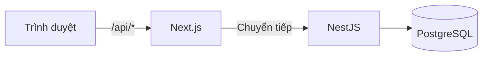
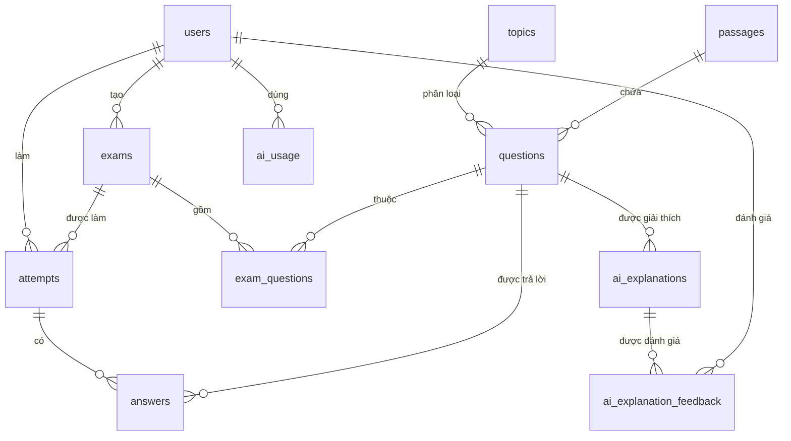

# Chương 3. Phân tích và thiết kế hệ thống

## 3.1. Yêu cầu chức năng
Yêu cầu được suy ra từ 11 màn hình thiết kế trong `/design`, chi tiết tại `docs/PRD.md`.

| Mã | Yêu cầu | Vai trò |
|---|---|---|
| F1 | Đăng ký, đăng nhập, đăng xuất | Mọi người |
| F2 | Quản lý câu hỏi, đoạn văn, lọc theo part, chủ đề, mức độ | Giáo viên |
| F3 | Nạp câu hỏi từ file JSON | Giáo viên |
| F4 | Tạo đề chọn tay hoặc ngẫu nhiên, xem trước, xuất bản | Giáo viên |
| F5 | Xem danh sách đề, làm bài có đếm giờ, tự lưu, gắn cờ, nộp bài | Học viên |
| F6 | Xem kết quả, đáp án, giải thích từng câu | Học viên |
| F7 | Xem thống kê điểm yếu và xu hướng 5 lần gần nhất | Học viên |
| F8 | Nhận và làm bộ ôn tập gợi ý | Học viên |
| F9 | Xem thống kê tổng hợp, câu hay sai, học viên cần hỗ trợ | Giáo viên |
| F10 | Giải thích câu chọn sai bằng AI, phản hồi hữu ích hay không | Học viên |

## 3.2. Yêu cầu phi chức năng
- **Bảo mật:** băm mật khẩu, kiểm tra quyền ở backend trên từng endpoint, không lộ đáp án trước khi nộp.
- **Độ tin cậy:** mất mạng tạm thời không làm mất bài, mỗi lượt chỉ chấm một lần.
- **Công bằng:** thời gian làm bài do máy chủ quyết định.
- **Giao diện:** tiếng Việt, dùng được trên điện thoại.

## 3.3. Quy tắc nghiệp vụ
- Đăng ký công khai chỉ tạo học viên. Nếu cho chọn vai trò như trên thiết kế ban đầu, bất kỳ ai cũng tự cấp được quyền giáo viên.
- Mỗi học viên chỉ có một lượt đang làm trên một đề.
- Hết giờ thì bài được chấm theo các câu đã lưu.
- Đáp án và giải thích chỉ trả về sau khi nộp.
- Câu bỏ trống tính là sai.
- Câu hỏi đã dùng không bị xóa mà được lưu trữ, để kết quả cũ không đổi.

## 3.4. Kiến trúc tổng thể

Trình duyệt chỉ giao tiếp với Next.js. Next.js chuyển các yêu cầu `/api/*` sang NestJS, nhờ đó cookie đăng nhập là cookie cùng nguồn và không cần mở CORS rộng. Mọi kiểm tra quyền và chấm điểm đều nằm ở backend.

Backend chia thành các module:

| Module | Trách nhiệm |
|---|---|
| `auth` | Đăng ký, đăng nhập, JWT, guard |
| `questions` | Câu hỏi, đoạn văn |
| `exams` | Tạo đề, chọn ngẫu nhiên, xuất bản |
| `attempts` | Làm bài, lưu nháp, chấm điểm, kết quả |
| `stats` | Thống kê học viên |
| `recommendations` | Gợi ý ôn tập |
| `teacher-stats` | Thống kê giáo viên |
| `ai` | Gọi Gemini, cache, giới hạn lượt, phản hồi |

## 3.5. Thiết kế cơ sở dữ liệu
Hệ thống có 11 bảng.

| Bảng | Vai trò |
|---|---|
| `users` | Tài khoản, vai trò, mật khẩu đã băm |
| `topics` | Chủ đề dùng để lọc và thống kê |
| `passages` | Đoạn văn của Part 6, 7 |
| `questions` | Câu hỏi, 4 lựa chọn, đáp án, giải thích, nguồn, giấy phép |
| `exams` | Đề thi chuẩn hoặc bộ ôn tập của học viên |
| `exam_questions` | Liên kết đề với câu hỏi, giữ thứ tự |
| `attempts` | Một lượt làm bài, thời hạn, kết quả |
| `answers` | Câu trả lời trong một lượt |
| `ai_explanations` | Cache lời giải thích AI theo câu hỏi, đáp án chọn và phiên bản prompt |
| `ai_usage` | Số lượt gọi AI mỗi ngày của từng người dùng |
| `ai_explanation_feedback` | Phiếu đánh giá hữu ích, mỗi người một phiếu |

Một số ràng buộc nằm trực tiếp ở cơ sở dữ liệu thay vì chỉ ở ứng dụng:
- `CHECK (cardinality(options) = 4)` bảo đảm mọi câu có đúng 4 lựa chọn.
- Chỉ mục duy nhất một phần trên (`user_id`, `exam_id`) khi `status = 'IN_PROGRESS'` bảo đảm chỉ có một lượt đang làm, kể cả khi hai yêu cầu đến cùng lúc.

## 3.6. Thiết kế API
API theo kiểu REST với tiền tố `/api`, gồm 42 endpoint. Đặc tả đầy đủ tại `docs/openapi.yaml`.

| Nhóm | Số endpoint | Vai trò |
|---|---|---|
| Xác thực, sức khỏe | 6 | Công khai hoặc đã đăng nhập |
| Chủ đề, câu hỏi, đoạn văn | 12 | Chủ yếu giáo viên |
| Đề thi | 7 | Giáo viên; học viên chỉ xem danh sách |
| Làm bài | 6 | Học viên |
| Thống kê học viên, gợi ý | 5 | Học viên |
| Thống kê giáo viên | 4 | Giáo viên |
| Giải thích bằng AI | 2 | Học viên |

## 3.7. Thiết kế giao diện
Giao diện theo hệ thiết kế trong `design/DESIGN.md` với 11 màn hình. Bản cài đặt lược bỏ các phần ngoài phạm vi như đăng nhập Google, quên mật khẩu, lớp học, chuỗi ngày học, và không dùng số liệu minh họa của thiết kế.

`[CẦN BỔ SUNG: chèn ảnh chụp màn hình từ /design và từ hệ thống thật]`
