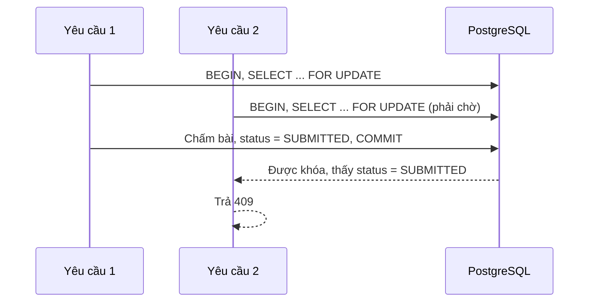

# Chương 4. Cài đặt hệ thống

## 4.1. Tổ chức mã nguồn
| Thư mục | Nội dung | Quy mô |
|---|---|---|
| `backend/` | API, schema, script (không tính test) | 43 tệp, 2.338 dòng |
| `backend/` | Mã test | 13 tệp, 1.361 dòng |
| `frontend/` | Giao diện (không tính test) | 30 tệp, 2.449 dòng |

Toàn bộ dự án chạy bằng một lệnh `npm run dev`: tạo file `.env` với khóa JWT ngẫu nhiên, cài gói, khởi động PostgreSQL, chạy migration, nạp dữ liệu mẫu, rồi chạy backend và frontend.

## 4.2. Xác thực và phân quyền
Mọi endpoint mặc định cần đăng nhập. `JwtAuthGuard` và `RolesGuard` đăng ký toàn cục, endpoint công khai phải khai báo `@Public()` rõ ràng. Cách này an toàn hơn việc gắn guard cho từng endpoint, vì quên khai báo thì endpoint bị khóa chứ không bị mở.

Khi đăng nhập sai, hệ thống trả cùng một thông báo cho sai email và sai mật khẩu, và vẫn so sánh với một hash giả khi email không tồn tại để thời gian phản hồi không làm lộ email nào đã đăng ký.

## 4.3. Nạp dữ liệu câu hỏi
Script `npm run import:questions` đọc file JSON và kiểm tra toàn bộ trước khi nạp. Mọi lỗi được gom lại kèm số dòng để sửa một lần. Việc tìm số dòng dùng một bộ quét đơn giản bỏ qua ký tự nằm trong chuỗi. Dữ liệu nạp trong một giao dịch, lỗi giữa chừng thì không nạp câu nào, và chạy lại không tạo bản trùng.

## 4.4. Làm bài
### 4.4.1. Đếm giờ phía máy chủ
Khi bắt đầu, máy chủ lưu `expires_at`. Trình duyệt chỉ nhận số giây còn lại để hiển thị, và cập nhật lại sau mỗi lần lưu. Đồng hồ hiển thị dùng `performance.now()` nên không bị ảnh hưởng khi người dùng chỉnh giờ máy. Dù trình duyệt có bị can thiệp, máy chủ vẫn từ chối lưu sau khi hết giờ.

### 4.4.2. Tự lưu
Trình duyệt ghi lại các câu đã đổi và gửi mỗi 5 giây, chỉ gửi những câu đã đổi. Nếu mất mạng, các câu chưa lưu được giữ lại và gửi ở chu kỳ sau, giao diện báo trạng thái cho người dùng. Hệ thống cũng lưu ngay khi người dùng chuyển tab.

### 4.4.3. Không lộ đáp án
Truy vấn đề thi cho học viên dùng `select` liệt kê từng trường được phép, nên đáp án không hề được đọc ra khỏi cơ sở dữ liệu. Cách này an toàn hơn việc lấy cả câu hỏi rồi xóa trường đáp án trước khi trả về, vì khi thêm trường mới thì trường đó không tự động bị lộ.

### 4.4.4. Chấm một lần


Lưu nháp cũng khóa cùng dòng, nên không thể chen vào giữa lúc chấm.

### 4.4.5. Gia hạn phiên
Đề có thể dài tới 300 phút trong khi token sống 2 giờ. Phòng thi gọi `POST /auth/refresh` mỗi 15 phút để phiên không hết hạn giữa bài. Lỗi này được phát hiện trong bước rà soát bảo mật.

## 4.5. Chấm điểm
Hàm `gradeAnswers` tách riêng, không phụ thuộc cơ sở dữ liệu nên dễ kiểm thử. Điểm ước lượng tính bằng:

```text
điểm = max(5, round(495 × số câu đúng / tổng số câu ÷ 5) × 5)
```

Công thức làm tròn theo bước 5 như thang TOEIC. Đây là quy đổi tuyến tính, nên giao diện luôn ghi rõ là điểm ước lượng.

## 4.6. Thống kê
Thống kê dùng SQL trực tiếp với `GROUP BY` và `FILTER` để tính ở cơ sở dữ liệu thay vì tải toàn bộ câu trả lời về ứng dụng. Tỷ lệ gần đây dùng CTE lấy 5 lần nộp mới nhất. Mọi truy vấn đều tham số hóa.

## 4.7. Thuật toán gợi ý ôn tập
Thuật toán dựa trên luật, không dùng mô hình ngôn ngữ, cài đặt tại `backend/src/recommendations/recommend.ts`.

1. **Chọn chủ đề yếu:** lấy tối đa 3 chủ đề có tỷ lệ đúng thấp nhất, bỏ chủ đề đã đúng hết. Khi bằng nhau, ưu tiên chủ đề có nhiều câu hơn vì kết quả đáng tin hơn.
2. **Chọn mức độ:** tỷ lệ đúng dưới 50% chọn Dễ, dưới 75% chọn Trung bình, còn lại chọn Nâng cao.
3. **Chia số câu:** chia 10 câu theo tỷ lệ sai bằng phương pháp phần dư lớn nhất, bảo đảm tổng đúng bằng 10.
4. **Chọn câu chưa làm:** ưu tiên mức phù hợp, thiếu thì lấy mức gần nhất.
5. **Bù câu còn thiếu:** lấy từ chủ đề yếu khác, sau đó từ các chủ đề còn lại.

Ví dụ: ba chủ đề có tỷ lệ sai 80%, 60%, 20%. Phần chia là 5,0; 3,75; 1,25. Lấy phần nguyên được 5, 3, 1, còn dư 1 câu, câu này thuộc chủ đề có phần dư lớn nhất, nên kết quả là 5, 4, 1.

Các ngưỡng 50% và 75% là lựa chọn thiết kế, chưa được kiểm chứng bằng thực nghiệm. `[CẦN SỐ LIỆU]`

## 4.8. Giải thích bằng AI
`[CHƯA TRIỂN KHAI]` Hiện tại trang kết quả hiển thị giải thích do người soạn nhập sẵn, kèm thông báo tính năng AI chưa khả dụng. Bảng `ai_explanations` đã có sẵn cho bước này.

## 4.9. Triển khai
Dự án có Dockerfile nhiều giai đoạn cho backend và frontend, chạy bằng người dùng không phải root, và `docker-compose.prod.yml` cho VPS. Hướng dẫn tại `docs/DEPLOYMENT.md`.

Hệ thống đã được triển khai tại https://luyenthitoeic-delta.vercel.app: frontend trên Vercel, backend và PostgreSQL trên gói miễn phí của Render, vùng Singapore. Gói miễn phí không có bước chạy trước khi deploy, nên migration và seed chạy khi container khởi động.
